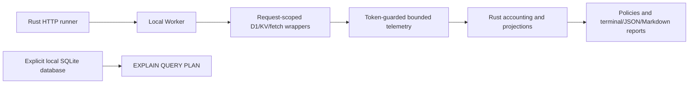

# QuotaLab

**Test your Cloudflare resource budgets before production does.**

QuotaLab runs representative HTTP workloads against a local Cloudflare Worker, observes D1 and KV operations, projects daily consumption, and enforces resource budgets in CI. Deterministic dependency failures test the application's actual HTTP behavior.

This is an engineering test harness. A pricing calculator cannot show that an endpoint scans an unindexed table or returns an uncontrolled error when KV is unavailable. QuotaLab executes those paths locally, without Cloudflare credentials or deployment.

## First run

Requires stable Rust, Node.js 22.22+ with pnpm, and a C compiler for bundled SQLite. macOS ARM64 and Linux x86_64 are the primary targets. Dependencies require network access during installation; test workloads use local bindings.

```sh
corepack pnpm install --frozen-lockfile
pnpm build
cargo build --workspace
cargo install --path crates/quotalab-cli --locked

quotalab test --config examples/basic-worker/quotalab.yaml \
  --managed --wrangler-config examples/basic-worker/wrangler.jsonc \
  --seed-sql examples/basic-worker/migrations/0001_users.sql \
  --output reports/healthy
```

The managed runner creates disposable D1/KV persistence, seeds 2,000 fixture users, starts Wrangler on loopback, runs 30 real requests, writes reports, and stops the process. The seed script resets data **only in that disposable database**. No deployment or API token is needed.

A locally verified healthy run observed 1–2 D1 rows read per lookup and projected about 31,800 D1 rows read/day at the configured traffic mix. CPU remains `unavailable`. Full reports are generated from each run; values can change with fixtures and runtime versions.

```sh
# Intentionally inefficient Worker: exits 2, as expected.
quotalab test --config examples/budget-violations/quotalab.yaml \
  --managed --wrangler-config examples/budget-violations/wrangler.jsonc \
  --seed-sql examples/budget-violations/migrations/0001_users.sql \
  --output reports/violations

# Dependency faults with assertions about actual response status/body.
quotalab test --config examples/basic-worker/faults.yaml \
  --managed --wrangler-config examples/basic-worker/wrangler.jsonc \
  --seed-sql examples/basic-worker/migrations/0001_users.sql \
  --output reports/faults
```

The inefficient example lacks an email index, writes a new KV key for every request, and returns 500 on an injected KV outage. Its projected 20,000 KV writes/day exceed the configured budget of 800. [Regression examples](docs/d1-analysis.md) explain the fixes; [captured reports](docs/example-reports/) contain actual local output.

## Integrate a Worker

The TypeScript package is prepared as `@quotalab/worker`; it is **not published**. Build it here and install from a local path (`pnpm add /path/to/quotalab/packages/worker`) in an existing Worker project. Package-name availability has not been established.

```ts
import { createQuotaLabInstrumentation } from "@quotalab/worker";

export default {
  fetch(request: Request, env: Env, ctx: ExecutionContext) {
    return createQuotaLabInstrumentation({
      enabled: env.QUOTALAB_LOCAL === "true",
      localTestMode: env.QUOTALAB_LOCAL === "true",
      token: env.QUOTALAB_TOKEN,
      d1Bindings: ["DB"],
      kvBindings: ["CACHE"],
    })
      .wrap(app)
      .fetch(request, env, ctx);
  },
};
```

`app` is your existing module Worker handler. Declare the two optional control variables in your Wrangler configuration with disabled/empty defaults, then generate `Env` using `wrangler types --strict-vars=false`. The examples demonstrate this integration with native D1 and KV bindings. The runner provides an ephemeral token using a private temporary environment file; it never passes the token as a command argument.

Privileged telemetry requires both explicit local-test configuration and a matching token. Host headers do not authorize instrumentation. Do not enable these controls in deployment settings. [Security and limitations](docs/limitations.md) describe the trust boundary.

## Architecture and evidence



| Provenance        | Meaning                                                                                   |
| ----------------- | ----------------------------------------------------------------------------------------- |
| `measured_local`  | Actual local HTTP timing or binding observations                                          |
| `measured_remote` | Reserved for genuine remote platform metrics; no remote resource collector is implemented |
| `estimated`       | Weighted traffic mix, daily projections, utilization and exhaustion estimates             |
| `simulated`       | Explicit synthetic dependency failures; never claimed as platform errors                  |
| `unavailable`     | Unknown, including production CPU time in local tests                                     |

**Local execution does not predict production CPU, account-wide usage, or exact platform enforcement.** `first()`, `raw()` and `exec()` preserve their native behavior and leave unavailable row counts unknown. Projections with incomplete measurements stay unavailable; JSON retains observed subtotals. Operations bypassing wrappers cannot be observed. Background `waitUntil()` work marks telemetry incomplete. External fetch counts exclude hidden redirect hops and unwrapped calls.

Supported services: Workers HTTP, D1, KV; optional aggregated Analytics Engine export. No hosted service, dashboard, production API collector, R2, or other service integrations are included.

## Commands and configuration

```sh
quotalab init                         # refuses to overwrite without --force
quotalab doctor --config examples/basic-worker/quotalab.yaml
quotalab limits show --profile workers-free
quotalab analyze --input reports/healthy/run.json --config examples/basic-worker/quotalab.yaml
quotalab report --input reports/healthy/run.json --format markdown
quotalab explain --database ./fixtures.sqlite --input reports/violations/run.json
quotalab test --help
```

Use `--format json` for clean machine output and `--output DIR` to persist configured formats. Diagnostics go to stderr. Terminal output uses no color; `--no-color` is accepted consistently. The config and report schemas are versioned under [schemas](schemas/).

| Exit | Meaning                                                                       |
| ---- | ----------------------------------------------------------------------------- |
| 0    | Enforced policies passed; review coverage warnings                            |
| 2    | Budget or HTTP/body/fault-behavior policy failed                              |
| 3    | Invalid configuration, setup, interrupted run, or transport execution failure |
| 4    | Required measurement unavailable with `missing_measurements: fail`            |

[Configuration](docs/configuration.md) covers weights, fixtures, assertions, custom profiles, existing account usage, and remote-target opt-ins. A local target must use a literal loopback IP. Redirects are never followed. Remote faults are always rejected.

## Development and CI

```sh
cargo fmt --all -- --check
cargo clippy --workspace --all-targets -- -D warnings
cargo test --workspace
pnpm typecheck
pnpm test
pnpm test:integration
pnpm check:schemas
pnpm format:check
```

The Workers tests use the current official `@cloudflare/vitest-plugin` integration and genuine local D1/KV. The integration suite asserts both successful and intentionally failing CLI runs, then validates schema conformance. It also verifies index fixes, deterministic outages, missing coverage, startup failures, timeouts, redirect refusal and remote safety.

[CI](.github/workflows/ci.yml) runs these checks without Cloudflare credentials and uploads reports even when checks fail. [The reusable example workflow](.github/workflows/quotalab-example.yml) runs the healthy managed fixture and writes a job summary.

Further reading: [getting started](docs/getting-started.md), [architecture](docs/architecture.md), [resource accounting](docs/resource-accounting.md), [fault injection](docs/fault-injection.md), [D1 analysis](docs/d1-analysis.md), [CI integration](docs/ci-integration.md), [limitations](docs/limitations.md).

Contributions should follow the [contributing guide](CONTRIBUTING.md) and [code of conduct](CODE_OF_CONDUCT.md). To report a vulnerability, see the [security policy](.github/SECURITY.md). QuotaLab is licensed under the [MIT License](LICENSE).
